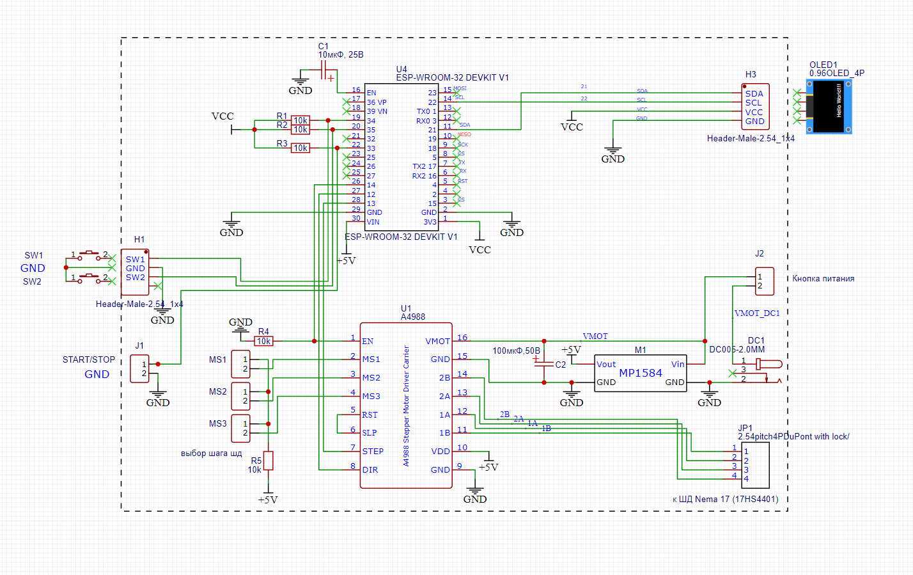

# Стенд ресурсных испытаний выключателей (Lindas SW)

[](https://www.espressif.com/)
[](https://www.arduino.cc/)
[]()
[]()

Автоматизированный испытательный стенд на базе микроконтроллера **ESP32** и шагового двигателя **Nema 17** для проведения ресурсных испытаний (тестирования на долговечность и количество срабатываний) бытовых выключателей света: одноклавишных, двухклавишных и проходных.

---

## 📌 Основные возможности

* **Автоматическое циклическое переключение:** привод на шаговом двигателе с кинематикой на базе библиотеки `GyverStepper2`.
* **Контроль обратной связи:** аппаратный опрос состояния контактов выключателя на каждом цикле. При залипании или несрабатывании стенд аварийно останавливается и фиксирует ошибку `ERROR`.
* **4 режима тестирования:**
  * 1-клавишный выключатель (`SW 1-key`)
  * 2-клавишный выключатель (`SW 2-key`) — отслеживание таблицы состояний 00-10-11-01
  * Проходной выключатель (`SW pass-through`)
  * Режим без обратной связи (`SW no feedback`)
* **3 режима вращения:**
  * По часовой стрелке (CW)
  * Против часовой стрелки (CCW)
  * Случайное направление (Random) с динамической компенсацией скорости для длинного хода
* **Информативный OLED-дисплей 0.96" (SSD1306):**
  * Отображение текущего состояния, выбранного режима и ошибки
  * Непрерывное отображение счётчика итераций на всех экранах (в работе, при паузе, в меню Wi-Fi и при ошибке)
* **Эргономичное управление одной кнопкой:**
  * Короткий клик (< 1 с) — Старт / Стоп теста
  * Удержание (> 5 с) — включение Wi-Fi точки доступа и открытие веб-интерфейса
  * Зажатие кнопки при включении питания — аппаратный сброс счётчика в 0
* **Встроенный Web-интерфейс и Captive Portal:**
  * Подключение через точку доступа `LindasSW` (192.168.4.1)
  * Настройка скорости (циклов в час), углов поворота, времени стабилизации контактов и редактирование счётчика
  * Встроенная страница **OTA-обновления** прошивки «по воздуху» (`/update`)
* **Бережное сохранение ресурса Flash-памяти (ESP32 NVS):**
  * Запись счётчика пачками по настраиваемой константе `COUNTER_SAVE_INTERVAL = 200` циклов
  * Гарантированное сохранение при событиях: остановка пользователем (`click-stop`), вход в меню настроек (`Wi-Fi`) и аварийная остановка (`ERROR`)
* **Высокая производительность:**
  * Ускорение `40 000 шаг/с²` для быстрого и естественного щелчка клавиши
  * Скорость до **~11 800 циклов/час** (без стабилизации) и до **~2 800 циклов/час** (с выдержкой 1 с)

---

## 🛠 Аппаратное обеспечение (BOM)

| № | Компонент | Назначение / Примечание |
|---|---|---|
| 1 | **ESP32 DevKit V1 (30 pin, CH340 / ESP-WROOM-32)** | Главный микроконтроллер |
| 2 | **Шаговый двигатель Nema 17 (17HS4401)** | 200 шаг/об, 1.8°/шаг |
| 3 | **Драйвер ШД A4988 / DRV8825** | С радиатором, микрошаг 1/16 (джамперы 1-1-1) |
| 4 | **OLED-дисплей 0.96" 128×64 (I2C, SSD1306)** | Вывод текущего статуса и счётчика |
| 5 | **Понижающий DC-DC преобразователь MP1584EN** | Питание логики от общего источника 12 В |
| 6 | **Блок питания 12 В / 1.5 А** | Основное питание шагового двигателя и схемы |
| 7 | **Кнопка управления PBS-26B** | Тактовая кнопка без фиксации (OFF-(ON)) |
| 8 | **Кнопка питания PBS-20A-2** | Кнопка с фиксацией (ON-OFF) |
| 9 | **Резисторы 10 кОм (SMD 1206)** | Подтяжка линий обратной связи и кнопки |
| 10 | **Конденсаторы 100 мкФ 50 В / 10 мкФ 25 В** | Фильтрация по питанию драйвера ШД |
| 11 | **Печатная плата (PCB)** | Файлы Gerber находятся в архиве `Gerber_Lindas_SW_PCB_*.zip` |

---

## 📐 Принципиальная электрическая схема

<p align="center">
  
</p>

---

## 🔌 Распиновка подключения (Pinout)

| Пин ESP32 | Подключение | Описание |
|---|---|---|
| **GPIO 13** | Драйвер `STEP` | Импульсы шага |
| **GPIO 12** | Драйвер `DIR` | Сигнал направления вращения |
| **GPIO 14** | Драйвер `ENABLE` | Включение/отключение питания обмоток двигателя |
| **GPIO 21** | Дисплей `SDA` | Линия данных I2C |
| **GPIO 22** | Дисплей `SCL` | Линия тактирования I2C |
| **GPIO 34** | Контакт обратной связи 1 | Контроль первой линии выключателя (INPUT) |
| **GPIO 35** | Контакт обратной связи 2 | Контроль второй линии выключателя (INPUT) |
| **GPIO 33** | Кнопка управления | Кнопка с внутренней подтяжкой `INPUT_PULLUP` (замыкание на GND) |
| **GPIO 36** | `analogRead(36)` | Инициализация генератора случайных чисел (`randomSeed`) |

---

## 💻 Веб-интерфейс и управление

### Подключение к стенду
1. Зажмите кнопку управления более чем на **5 секунд**.
2. На OLED-дисплее появится сообщение `Wi-Fi AP: LindasSW` и IP: `192.168.4.1`.
3. Подключитесь со смартфона или ПК к открытой Wi-Fi сети **LindasSW**.
4. В браузере откройте адрес `http://192.168.4.1` (при поддержке Captive Portal страница откроется автоматически).

### Доступные настройки:
* **Режим тестирования:**
  * Выключатель 1-кл
  * Выключатель 2-кл
  * Выключатель проходной
  * Без обратной связи
* **Направление вращения:**
  * По часовой
  * Против часовой
  * Случайно
* **Параметры цикла:**
  * *Циклов в час:* желаемая интенсивность тестирования
  * *Начальный угол (°):* угол первого поворота (по умолчанию `145°`)
  * *Время стабилизации (мс):* пауза после щелчка перед проверкой контактов
  * *Счётчик циклов:* возможность скорректировать текущее значение
* **OTA-прошивка:** переход на страницу `/update` для загрузки нового бинарного файла прошивки без подключения USB-кабеля.

---

## ⚙️ Сборка и прошивка

### Необходимые библиотеки
Установите через менеджер библиотек Arduino IDE:
* [GyverStepper](https://github.com/GyverLibs/GyverStepper) (версия с `GyverStepper2.h`)
* [Adafruit SSD1306](https://github.com/adafruit/Adafruit_SSD1306)
* [Adafruit GFX Library](https://github.com/adafruit/Adafruit-GFX-Library)

Встроенные библиотеки ESP32 Core:
* `WiFi.h`, `WebServer.h`, `DNSServer.h`, `Update.h`, `Preferences.h`, `Wire.h`

### Настройки платы в Arduino IDE
* **Плата:** `ESP32 Dev Module`
* **Flash Frequency:** `80MHz`
* **Partition Scheme:** `Default 4MB with spiffs (1.2MB APP/1.5MB SPIFFS)` или `Minimal SPIFFS (Large APPS with OTA)`
* **Upload Speed:** `921600`

---

## 🔒 Защита Flash-памяти

В прошивке реализован алгоритм сбережения ресурса NVS (Non-Volatile Storage) Flash-памяти ESP32:
```cpp
const unsigned int COUNTER_SAVE_INTERVAL = 200; // сохранение пачками каждые N циклов
```
* При круглосуточном тестировании данные записываются во Flash не на каждом шаге, а порциями по 200 циклов, что продлевает жизнь микроконтроллера более чем в 200 раз.
* При ручной остановке или обнаружении сбоя в памяти всегда сохраняется самое последнее актуальное значение.
